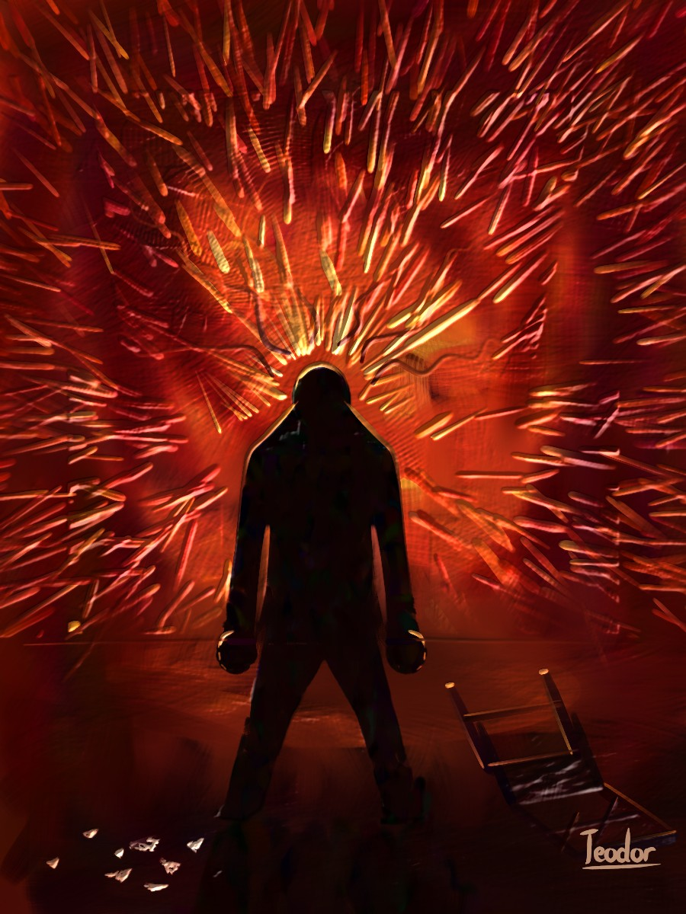

<h1 align="center">Teodor</h1>

**Can an AI paint the way a human painter does?**

### → See the paintings at [teodor.robertontiu.com](https://teodor.robertontiu.com)

  
  
  

---

## What this is

Most AI images appear in a single step: a prompt goes in, a picture comes out. Teodor is an experiment in the opposite direction. He is an AI painter who works the way a human painter works: he starts from a feeling, makes a mark, steps back, looks, feels what the canvas does to him, and decides the next mark from there. He builds the painting slowly, over dozens of short sessions at a simulated oil-paint easel, until one more stroke would only be explaining.

The question isn't whether the result looks like a painting. It's whether the *process* can be made analogous to a human one, and whether a painting made that way carries something a person can feel.

It started at 2 a.m. with a simple question to Claude, *"Can you paint?"*, and grew over a night and a day into a painter with a studio, a method, a journal and a signature.

## How Teodor paints

Every part of his process is modeled on research into how human painters actually work.

**He starts from a feeling, not a picture.** Teodor is given a theme, like *war* or *happiness*, and finds the feeling inside it he most needs to say, often two feelings pulling against each other. Every decision after that is checked against it: does the canvas carry it yet, or has it drifted into something else?

**He draws first, then makes and matches.** Painters don't copy what they see with an "innocent eye"; they start from a schema, a first rough idea of the forms, and tighten it by placing marks, comparing and correcting, over and over. Art historian E. H. Gombrich called this *making and matching*. Teodor starts with a drawing (a lit 3D blockout of the scene, or a composition of color fields for abstract work), paints over it, and revises the drawing when the painting shows him something truer.

**He works in short look-and-paint cycles.** Eye-tracking studies of a professional portrait painter found he glanced between his subject and the canvas 12 to 22 times a minute, working detail by detail in short episodes, with the hand often continuing while the eye looked elsewhere. Teodor works in short episodes too, always looking again before the next one.

**He steps back and leans in.** Skilled artists start with the whole and move fluidly between the big shapes and the details. Teodor squints at a blurred thumbnail to check the composition, checks the values in grayscale, and zooms in for fine work.

**He keeps finding the problem.** In a classic study of art students, those who kept discovering what their picture was about while making it produced the most original work, and were the ones still painting years later. Teodor explores a few ideas before committing, and lets the painting change his plan.

**His feeling moves his hand.** People viewing a painting covertly simulate the gestures that made its brushstrokes, so the speed, pressure and rhythm of a mark carry emotion. Before each episode Teodor sets how he feels (calm or agitated, loose or tense, dark or warm, impulsive or careful), and that changes how his brush moves: its speed, pressure, tremor, angularity and where it breaks into dry brush.

**He works in stages and gets critiqued.** Like professional artists, he moves from conception to development to realization to finishing. Between stages a fresh critic, who knows only the theme, looks at the canvas and says what it feels and what's weak, and Teodor answers that in paint.

**He signs his work.** The last brushstroke on every painting is his signature: *Teodor*.

Each painting comes with Teodor's journal (every decision, in his own voice), the drawings behind it, the critiques, and a time-lapse of it being painted. You'll find them in [`rounds/`](rounds).

## The research behind it

- E. H. Gombrich, [*Art and Illusion: A Study in the Psychology of Pictorial Representation*](https://press.princeton.edu/books/paperback/9780691070001/art-and-illusion) (1960). The schema and "making and matching".
- R. C. Miall & J. Tchalenko, ["A Painter's Eye Movements: A Study of Eye and Hand Movement during Portrait Drawing"](https://muse.jhu.edu/article/19624), *Leonardo* 34(1), 2001; J. Tchalenko & R. C. Miall, ["Eye–Hand Strategies in Copying Complex Lines"](https://pmc.ncbi.nlm.nih.gov/articles/PMC6010166), *Cortex*, 2009. Short eye–hand cycles.
- J. E. Drake, A. Riccio, R. Chamberlain & A. Kozbelt, ["Artists Have Superior Local and Global Processing Abilities but Show a Preference for Initially Drawing Globally"](https://eprints-gro.gold.ac.uk/30426/1/Local%20Global%20Paper%20Accepted.pdf); S. Park, L. Williams & R. Chamberlain, ["Global Saccadic Eye Movements Characterise Artists' Visual Attention While Drawing"](https://eprints-gro.gold.ac.uk/29676/) (2021). Whole first, then fluid switching between whole and detail.
- J. W. Getzels & M. Csikszentmihalyi, *The Creative Vision: A Longitudinal Study of Problem Finding in Art* (1976); see Keith Sawyer's account, ["The 1960s Art School Experiment That Redefined Creativity"](https://thereader.mitpress.mit.edu/the-1960s-art-school-experiment-that-redefined-creativity/). Problem finding.
- M.-A. Mace & T. Ward, "Modeling the Creative Process: A Grounded Theory Analysis of Creativity in the Domain of Art Making", *Creativity Research Journal* 14(2), 2002, based on [Mace's doctoral study of professional artists](http://hdl.handle.net/10092/4577). The stages of conception, development, realization and finalization.
- D. Freedberg & V. Gallese, ["Motion, Emotion and Empathy in Esthetic Experience"](https://doi.org/10.1016/j.tics.2007.02.003), *Trends in Cognitive Sciences* 11(5), 2007. Viewers feel the gestures behind brushstrokes.
- A. Hertzmann, ["Painterly Rendering with Curved Brush Strokes of Multiple Sizes"](https://mrl.cs.nyu.edu/publications/painterly98/), SIGGRAPH 1998. The technique behind Teodor's hand when he paints over his drawing: big brushes first, smaller ones only where needed, strokes following the form.

More on how each idea shaped the studio is in [`docs/research.md`](docs/research.md).

## Want to know more?

- [`docs/experiments.md`](docs/experiments.md): how the studio evolved from the first stroke to now, and what each painting taught
- [`AGENTS.md`](AGENTS.md): the technical handbook (the paint engine, the 3D drawings, how a painting session is run)
- [`site/`](site): the showcase website

## Credits

An experiment by [Robert Ontiu](https://github.com/robertontiu), built with Claude (Anthropic). The paintings, journals and titles are Teodor's.

## License

[MIT](LICENSE) © 2026 Robert Ontiu
