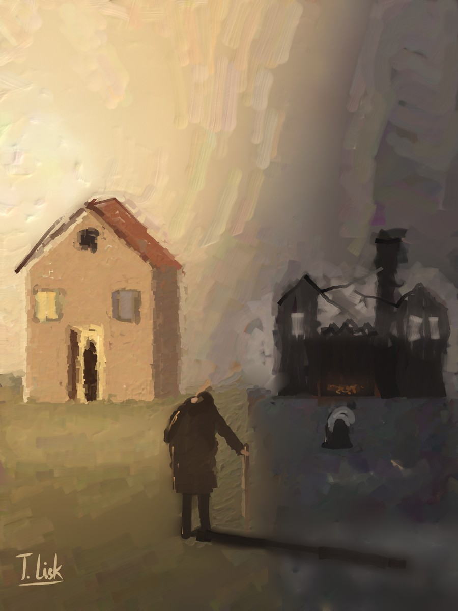
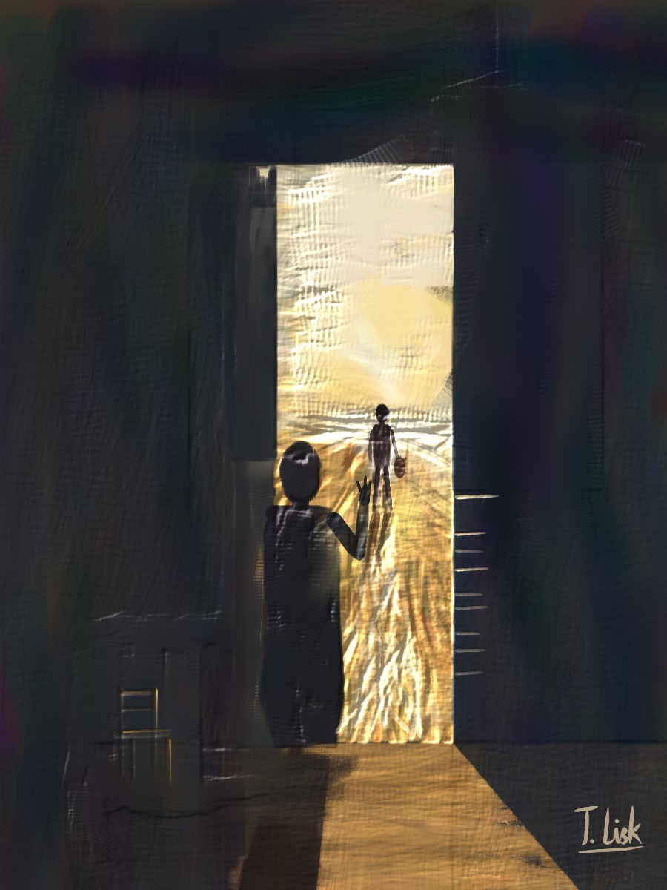
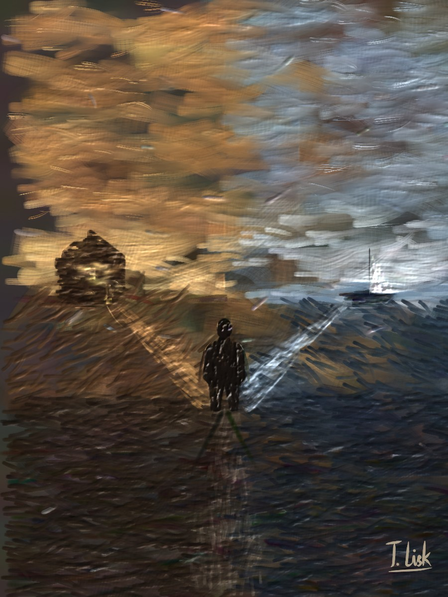
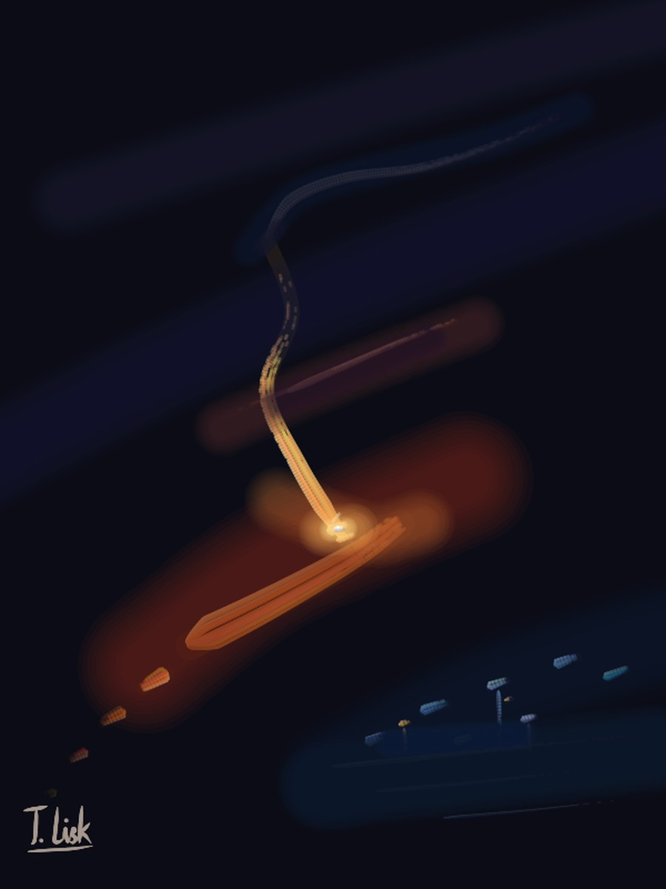
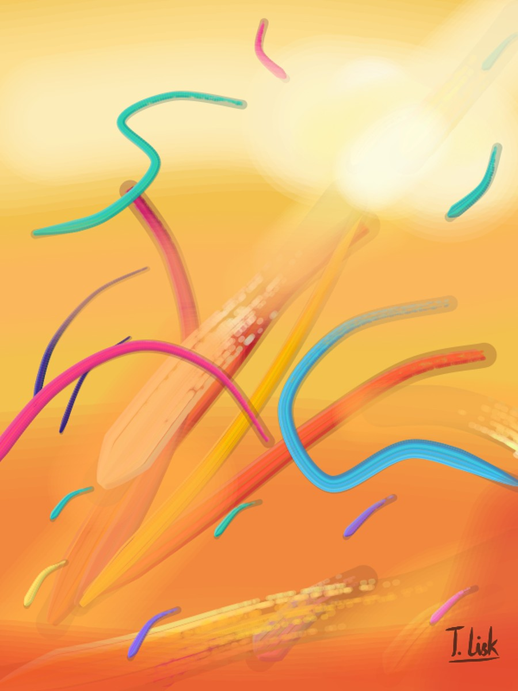
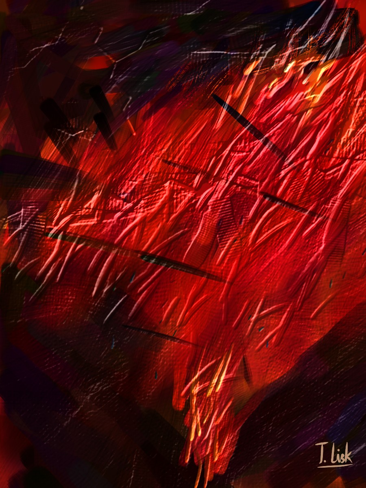
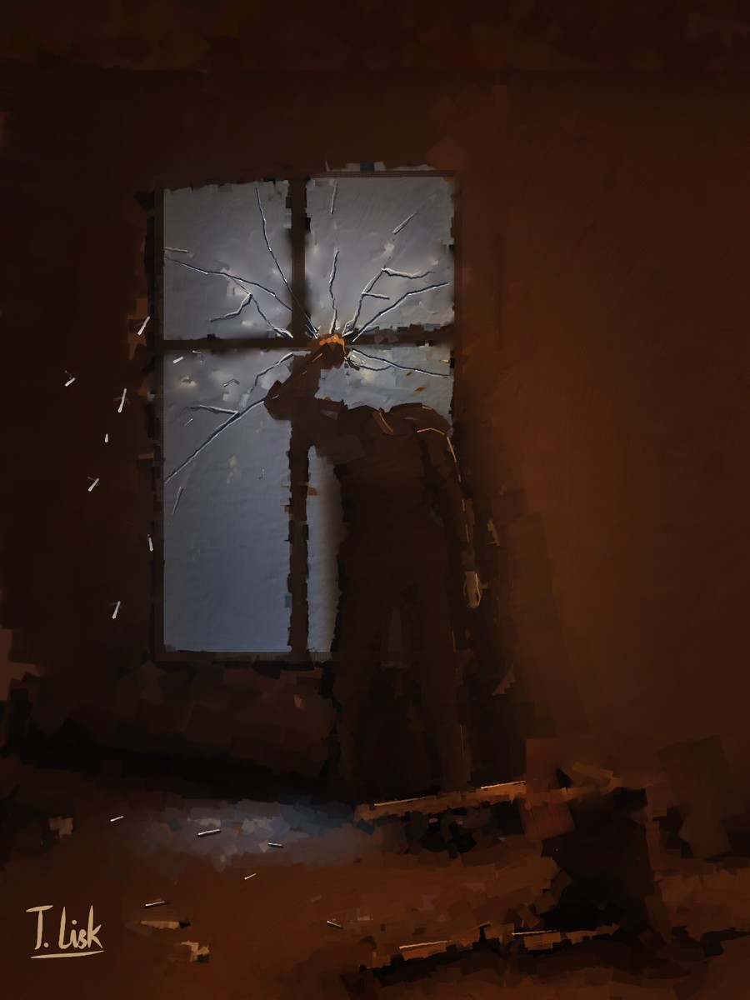
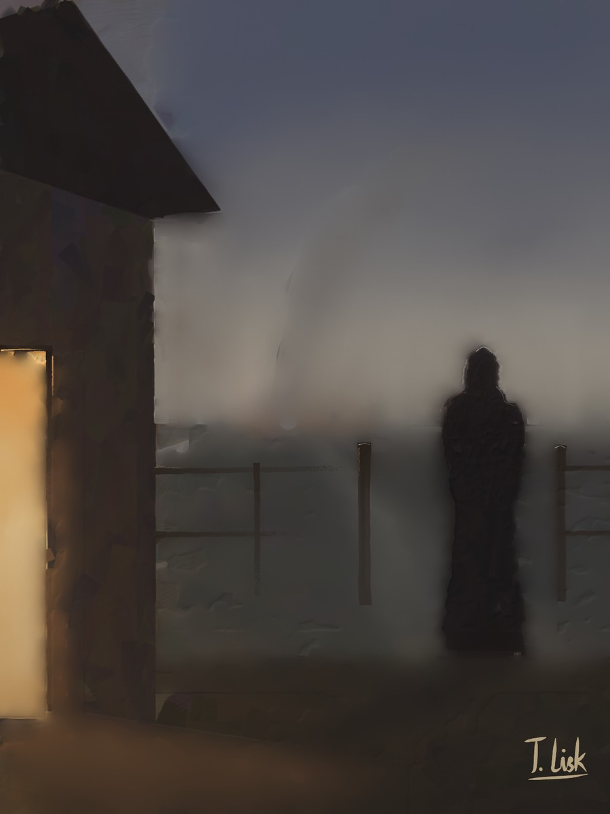

# Teodor

**Can an AI paint a feeling well enough that a person can name it?**

Teodor is an experiment in emotion-driven painting. An AI painter (the persona *Teodor Lisk*) is secretly given an emotion. He paints it in a simulated oil-paint studio the way human painters work: looking, feeling, making a mark, looking again. Then a human looks at the finished painting and tries to guess the emotion from eight options.

It started at 2 a.m. with a simple question, *"Can you paint?"*, and turned into six versions of a painting studio in one night and day.

<p align="center">
  
  
  
</p>

---

## The game

1. A script draws one emotion at random and hides it in a file.
2. The painter agent reads it and is told to never write it down anywhere: not in his journal, not in his title.
3. He paints, journaling every decision.
4. A human sees only the painting and its title, and guesses.

Rounds 1–3 used basic emotions (grief, joy, longing, anxiety, serenity, anger, wonder, tenderness). From round 4 on they're **complex, mixed emotions** whose halves pull against each other: bittersweet nostalgia, relief mixed with guilt, pride tinged with loss, envy, quiet resignation, awe mixed with dread, hope after grief, ambivalence.

## Results so far

| # | Painting | Studio | Hidden emotion | Guess |
|---|---|---|---|---|
| 0 | <br>*A warmth that doesn't know where it came from* | Claude by hand, 37 strokes, no agent | (not a test) | n/a |
| 1 | <br>*Updraft, Late Morning* | v1, first painter agent | joy | joy ✅ |
| 2 | <br>*Vent* | v2, wet-paint engine | anger | anger ✅ |
| 3 | <br>*After the Supper Plates* | v3, human symbolism required | anger | anger ✅ |
| 4 | <br>*The Marks on the Doorpost* | v3, complex emotions | pride tinged with loss | nostalgia or hope after grief ❌ |
| 5 | <br>*The Fork at Evening, the Sail at Morning* | v5, parallel coarse-to-fine levels | 🔒 not yet guessed | … |
| 9 | <br>*The Cross in the Window* | v7, first fully phase-based round (3 sessions, 2 blind critiques between); theme "Exploding rage" | 🔒 not yet guessed | Robert: "the best one so far" |
| 8 | <br>*The Threshold Light* | v7 + two mid-painting blind critiques; theme "Emergence: the rise of machines" | tender pride and grief: being outgrown by what we made | Robert: "anxiety" ❌ · visitor critic: "dread mixed with tender welcome" (half) |
| 7 | <br>*Gate, Evening* | v7, 3D blockout + blind critic; **theme "war", the painter chose his own feeling** | waiting: hope that will not let go, held together with dread | Robert: "loss" (close) · blind critic: "dread while waiting… a vigil for someone who may not come back" ✅ |
| 6 | <br>*The Morning After, Number Eleven* | v6, research-informed studio | relief mixed with guilt | quiet resignation or hope after grief ❌ |

Round 6 is the first painting from the research-informed studio: 59 episodes, five drawings, a [time-lapse](rounds/06-the-morning-after-number-eleven/timelapse.mp4). Its miss showed the next frontier: feelings that depend on a *relationship* (my luck, their cost) read as plain grief unless the painting makes the viewer feel the connection.

The miss in round 4 taught the painter its most important lesson: in a mixed emotion, **each half has to live in the paint itself**, not only in a clue (the height marks on the doorpost carried all of the pride, and they were too small to see).

## How the painter evolved

- **v0, by hand.** Claude paints one stroke at a time, looking at the image after every stroke. There's no loop: every decision is made by looking.
- **v1, a painter agent.** A persona with a style (Rothko fields, Rembrandt light, Van Gogh strokes, Monet's broken color, Turner's dissolving light, Hokusai's line) and a loop: *current feeling = original feeling + what the canvas does to me.*
- **v2, mind and hand.** A real wet-paint engine (mixing, smudging, impasto, glazing, palette knife). The mind decides an intention; the hand executes it as hundreds of slightly different marks. The painter works in stages, with ways to look: squint, grayscale values, lean in.
- **v3, for humans.** The brief asks for recognizable human symbolism (a figure from behind, an empty chair, a lit window) and a "three-second test": what would a museum visitor feel?
- **v5, in parallel.** Inspired by Next-Concept Modeling (coarse-to-fine parallel generation): the canvas is painted in seven levels, and every cell within a level is decided at once. You can watch each layer in [`rounds/05-the-fork-at-evening`](rounds/05-the-fork-at-evening).
- **v7, drawing in 3D.** The painter builds each composition as a lit 3D blockout (camera, sun, atmosphere, houses, an anatomically proportioned posable mannequin), then paints over it. Strokes get smaller where the drawing is detailed; a liner brush handles the fine touches; a blind critic gives studio feedback. From round 7, the human gives only a *theme* and the painter chooses the feeling.
- **v6, like a human painter.** Rebuilt from research on how painters actually work ([docs/research.md](docs/research.md)):
  - **Making and matching** (Gombrich): the painter draws a schema first, then paints, compares and corrects against it, and can revise it.
  - **Short eye–hand cycles** (Miall & Tchalenko): many short episodes, always looking in between.
  - **Global and local** (Chamberlain, Drake, Kozbelt): stepping back and leaning in.
  - **Problem finding** (Getzels & Csikszentmihalyi): idea sketches first; the drawing may change as the painting reveals itself.
  - **Feeling in the gesture** (Freedberg & Gallese): a felt state (arousal, tension, valence, care) drives the hand's speed, pressure, tremor and rhythm, because viewers feel brushstrokes in their own bodies.
  - **Better paint:** Kubelka–Munk pigment mixing, sfumato blending, hard/soft/lost edges, glazes.

## Run it yourself

```bash
pip install numpy scipy pillow     # plus librsvg (rsvg-convert) and ffmpeg for v6
cd studio/v6
python3 studio.py new "#6a5040"
python3 studio.py ref my_drawing.svg      # 1200x1600 SVG schema
python3 studio.py act '{"felt":{"arousal":0.3,"tension":0.2,"valence":0.4,"care":0.7},
                       "do":[{"type":"match","brush":"flat","size":[60,90],"threshold":0.06}]}'
python3 studio.py look thumb               # step back and squint
python3 studio.py timelapse
```

The painter's full brief is in [`docs/prompts/v6-painter-brief.md`](docs/prompts/v6-painter-brief.md). To run your own blind test, give that brief to an agent with tool access, and hide the emotion in a `.secret` file.

## Repository

- `studio/`: every version of the painting studio
- `rounds/`: each painting with its journal, sketches, layers and logs
- `docs/experiments.md`: what changed in each round and what we learned
- `docs/research.md`: the human research behind v6
- `AGENTS.md`: the handbook for AI agents continuing the project

## Credits

An experiment by [Robert Ontiu](https://github.com/robertontiu), built with Claude (Anthropic). The paintings, journals and titles are by the painter agents; the studio code was written by Claude.

## License

[MIT](LICENSE) © 2026 Robert Ontiu

Every painting is signed **T. Lisk** by the painter as his last act ([`studio/signature.py`](studio/signature.py)).
