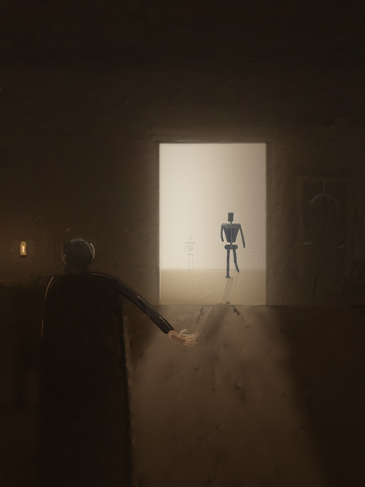

# Teodor

**An AI painter is given a feeling. He paints it. You try to name it.**

### → See the paintings at [teodor.robertontiu.com](https://teodor.robertontiu.com)

  
  
  

---

## What this is

Teodor is an experiment in whether a machine can make a painting that *feels* like something, and whether a person standing in front of it can feel the same thing.

It started at 2 a.m. with a simple question to Claude: *"Can you paint?"* A night and a day later there was a painter: an AI persona called Teodor, working in a simulated oil-paint studio, and a game:

1. A feeling is chosen in secret. At first it was drawn at random; later Teodor chose it himself, from a theme like *war* or *grinding jealousy*.
2. Teodor paints it. He never writes the feeling down, not in his notes and not in the title.
3. A person looks at the finished painting and says what they feel.
4. Then the secret is revealed.

Sometimes it lands. A painting on the theme *war* was read by a stranger as "a vigil for someone who may not come back", almost word for word what Teodor meant. Sometimes it misses in an interesting way: a painting about a parent proudly letting a grown child go was read as dread, because everyone saw the figures *arriving* through the door instead of leaving.

## The idea behind it

Most AI images appear in one step from a prompt. Teodor works the way human painters work, closely following research on how they actually do it:

- **He starts from a feeling, not a picture.** Each step is decided by looking at the canvas and asking what it does to him right now, and whether a stranger would feel it too.
- **He draws first, then paints.** Like old masters with their cartoons, or concept artists with 3D blockouts, he builds the scene, then paints over it, comparing and correcting (what Gombrich called "making and matching").
- **His feeling moves his hand.** Calm, tense, warm or agitated, his state changes the speed, pressure and rhythm of his strokes, because viewers feel brushstrokes in their own bodies.
- **He works in short look-and-paint cycles**, stepping back to squint and leaning in for detail, the way eye-tracking studies show painters do.
- **He gets critiqued.** Along the way, a fresh critic who knows nothing about his feeling looks at the canvas and says what it feels. If the critic is wrong, the painting is wrong.
- **He signs his work.** Every painting carries his brush signature, *Teodor*.

Each painting comes with its journal (every decision, in his own voice), the drawings behind it, and a time-lapse of it being painted.

## The paintings so far

| | Painting | Hidden feeling or theme | What a viewer felt |
|---|---|---|---|
| 1 | *Updraft, Late Morning* | joy | joy ✅ |
| 2 | *Vent* | anger | anger ✅ |
| 3 | *After the Supper Plates* | anger | anger ✅ |
| 4 | *The Marks on the Doorpost* | pride tinged with loss | nostalgia, or hope after grief ❌ |
| 5 | *The Fork at Evening, the Sail at Morning* | 🔒 still a secret | … |
| 6 | *The Morning After, Number Eleven* | relief mixed with guilt | resignation, or hope after grief ❌ |
| 7 | *Gate, Evening* | theme *war*: waiting, hope held together with dread | "loss"; a critic: "a vigil for someone who may not come back" ✅ |
| 8 | *The Threshold Light* | theme *the rise of machines*: pride and grief at being outgrown | "anxiety" ❌ |
| 9 | *The Cross in the Window* | theme *exploding rage* | 🔒 still a secret |

Round 0 was Claude's own first painting, made by hand before Teodor existed. Each round has its own folder in [`rounds/`](rounds), with the painting, Teodor's journal, his drawings, the critics' readings and a time-lapse.

## Want to know how it works?

- [`docs/experiments.md`](docs/experiments.md): what changed from round to round, and what each painting taught us
- [`docs/research.md`](docs/research.md): the research on human painters the studio is built on
- [`AGENTS.md`](AGENTS.md): the technical handbook (the paint engine, the 3D blockouts, how a round is run)
- [`site/`](site): the showcase website

## Credits

An experiment by [Robert Ontiu](https://github.com/robertontiu), built with Claude (Anthropic). The paintings, journals and titles are Teodor's.

## License

[MIT](LICENSE) © 2026 Robert Ontiu
